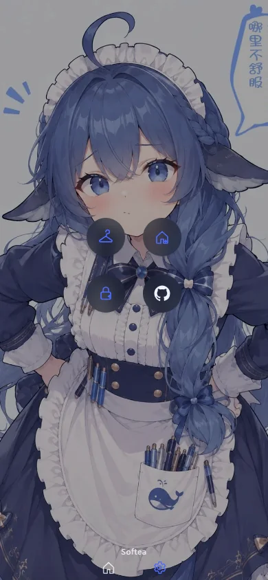

# 鲸驱 / WhaleGo

一个只有两页的 Android 小工具：在广告页替你点「跳过 / 关闭广告」，其余时间它安静地当壁纸 App。不联网、不上传、不读输入。

<p>
  
  
  
  
</p>

## 功能

- **无障碍跳过广告**：识别「跳过 / 跳过广告 / 关闭广告 / skip / close / ×」以及「35 | 跳过」这类倒计时按钮；先 `ACTION_CLICK`，无效时在按钮中心补一次无障碍手势。节点文字被拆成「跳」「过」也能拼起来判断。
- **61 张壁纸**：1 张默认 + 3 个公开图站各 20 张，三列网格选择。
- **5 种背景**：默认渐变、白色、黑色、跟随系统、关闭。
- **同步壁纸**：一键设为桌面或锁屏；单线程串行写入，成功 / 失败都有提示，连续点击不会把系统队列打满。
- **两页结构**：主页固定不可上下滑，右滑进设置；底部房子 / 齿轮切换。
- **纯图标设置**：皮肤库、同步桌面、同步锁屏、GitHub，四个圆钮，没有多余文字。
- **首次启动引导**：说明为什么要开无障碍，点「走起」直达系统设置，点「出走」退出。

## 安装

从 [Releases](https://github.com/JumpTea/whalego/releases/latest) 下载 `whalego-0.2.2.apk`（minSdk 26 / targetSdk 35）。

1. 安装并打开，按弹窗点「走起」。
2. 在系统的无障碍设置里启用「鲸驱 · 广告跳过」。
3. 返回 App 即可。无障碍开启后，广告页出现跳过按钮时会被自动点击。

> APK 使用调试证书签名，方便直接安装。要长期分发请自备 release keystore，并在构建时用环境变量指定。

## 构建

需要 JDK 17 与 Android SDK（platform 35、build-tools 35.0.0），**不需要 Gradle**。构建脚本直接调用 `aapt2`、`javac`、`d8`、`zipalign`、`apksigner`。

```powershell
$env:ANDROID_SDK_ROOT = "$env:LOCALAPPDATA\Android\Sdk"
$env:JAVA_HOME = "<JDK 17 安装目录>"
node tools/build-apk.mjs
```

产物在 `dist/whalego.apk`，脚本会打印大小与 SHA-256。版本号写在 `version.properties`。

签名默认使用 `.signing/debug.keystore`（不存在会自动生成）。需要换签名时设置：

```powershell
$env:WHALEGO_KEYSTORE = "<你的 keystore 路径>"
$env:WHALEGO_KEYSTORE_PASS = "..."
$env:WHALEGO_KEY_ALIAS = "..."
$env:WHALEGO_KEY_PASS = "..."
```

## 目录

```
android/                 Android 工程（无 Gradle）
  AndroidManifest.xml
  src/com/tealepai/whalego/
    MainActivity.java          单 Activity + WebView + 原生桥
    AdAccessibilityService.java 无障碍服务（遍历 + 手势点击）
    AdRules.java               纯 Java 的跳过标签判断（可单测）
  assets/               index.html / style.css / app.js / 壁纸 / 开屏图
  res/                  图标、主题、文案
tools/build-apk.mjs     手工构建脚本
tools/process-assets.py 素材加工（开屏 GIF、精灵图、图标、默认壁纸）
version.properties
```

界面是 WebView + 原生桥：`window.whale` 提供无障碍状态、壁纸同步、偏好读写、系统深浅色、底部安全区等能力；原生侧通过 `whaleResume / whaleBack / whaleSyncResult` 等回调驱动页面。

## 隐私

- `AndroidManifest.xml` 只申请 `SET_WALLPAPER`，**没有 `INTERNET` 权限**，安装后无法联网。
- 无障碍服务只读取当前窗口的控件文本与可点击性，用于匹配跳过按钮；不读取输入内容、不截图、不保存浏览历史、不上传任何数据。
- 壁纸同步调用系统 `WallpaperManager`，全程在本机完成。
- 偏好只存在本机 `SharedPreferences`。

## 已知限制

- 能否跳过取决于目标 App 是否把按钮暴露给无障碍服务。WebView、自绘控件、游戏引擎里的广告可能识别不到。
- 部分系统会限制第三方应用设置锁屏壁纸；失败时会提示，不会静默失败。
- 界面在浏览器层按 390×844 / 360×800 / 320×568 三档验证过；原生部分（系统开屏、无障碍服务、壁纸同步、返回键）尚未在真机或模拟器上验证。

## 参考与致谢

广告跳过的判断策略参考了这两个 MIT 项目，但没有直接复制它们的源文件：

- [zfdang/Android-Touch-Helper](https://github.com/zfdang/Android-Touch-Helper)：`flagIncludeNotImportantViews`、可点击祖先、`performAction` 无效后用 `dispatchGesture` 补点。
- [madeye/ad-skipper](https://github.com/madeye/ad-skipper)：无障碍节点遍历与广告上下文的分层判断思路。

对应 MIT 许可见 [NOTICE.md](NOTICE.md)。如果你要再分发，请同时保留这两份项目的版权与许可声明。

## 素材与许可

- 代码以 [MIT](LICENSE) 发布。
- 开屏、图标、默认壁纸由项目作者提供的图片加工而来；其余 60 张壁纸来自三个公开图站，逐条来源见 [CREDITS.md](CREDITS.md)。图像版权归原作者，不在 MIT 许可范围内，详见 [NOTICE.md](NOTICE.md)。
- 应用内标注「仅供学习使用」。如果你是权利人且不希望作品出现在这里，请开 issue，对应文件会被移除。
